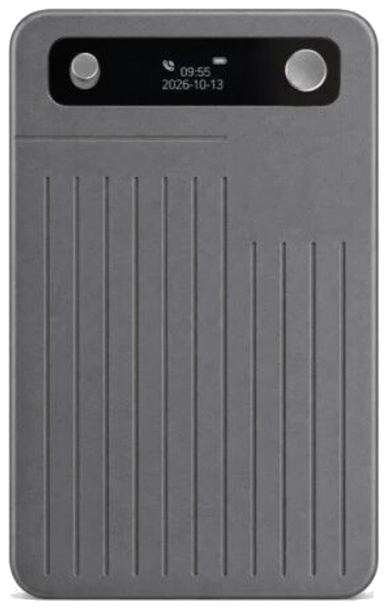

# 扩展硬件详情

本地语音助手可通过蓝牙连接 **CB08 录音卡** 与 **AI Passport 电子工牌**，作为随身音源与会议控制。同一时间请只让一个程序连接同一台设备。

连接步骤见 [使用教程 · 连接硬件](GUIDE.md#连接硬件)。

---

## CB08 录音卡

  

- 实时语音上行到本机转写 / 听写
- 支持设备上录音文件的列表与下载
- 适合需要留存卡上录音、并回传到电脑的场景

---

## AI Passport 电子工牌

  

- 实时语音上行（设备上无录音文件分区）
- 会议按键：上键开始录音，下键停止，OK 暂停或继续
- 听写由电脑 Fn 控制。听写中：上键写入、下键撤回、OK 回车（听写音源需设为工牌）
- 适合佩戴使用、现场按键控制会议节奏的场景

产品官网：[ai-passport.folotoy.cn](https://ai-passport.folotoy.cn/) · [快速上手](https://ai-passport.folotoy.cn/guides/getting-started/)

### 烧录固件

1. 从本仓库 [Release](https://github.com/local-voice-assistant/local-voice-assistant/releases/latest) 下载 `AI-Passport-firmware.bin`，对照同页 `SHA256SUMS.txt`。
2. 打开官网 [在线刷机](https://ai-passport.folotoy.cn/tools/web-flasher/)，用 USB 连接工牌，选择该文件，从地址 `0x0` 写入（8 MB Flash）。整片写入可能清掉设备上已有数据。
3. 烧录后打开本地语音助手，蓝牙连接工牌，即可作为转写 / 听写音源，并用机身按键控制会议。

---

返回 [首页](README.md) · [软件介绍](PRODUCT.md) · [使用教程](GUIDE.md)
