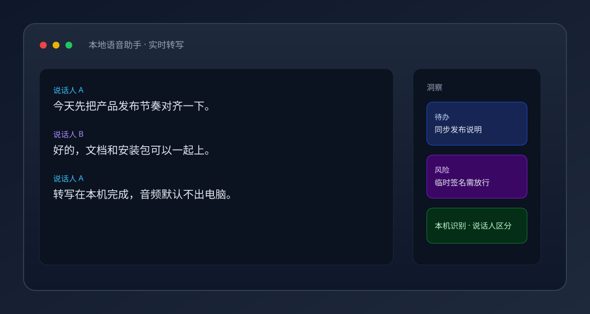
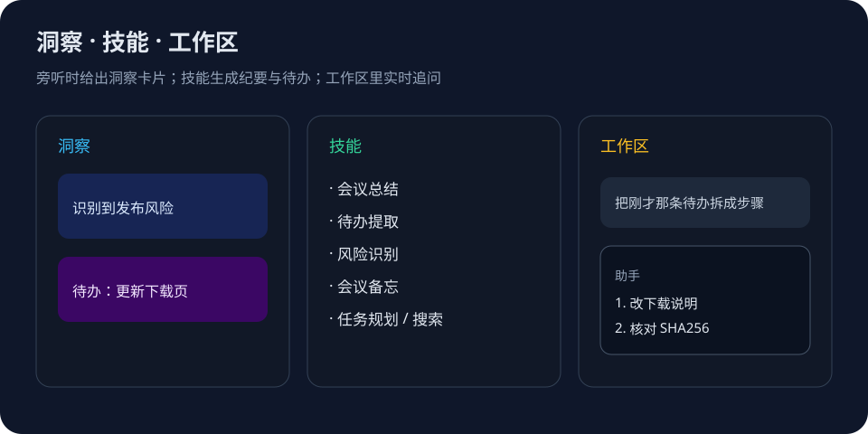
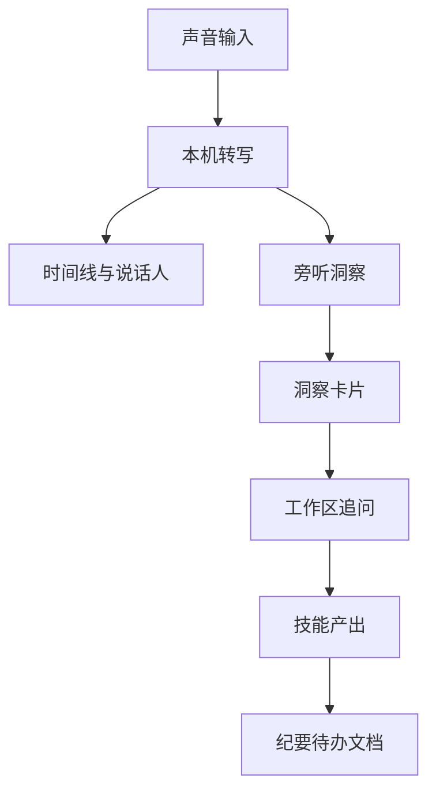
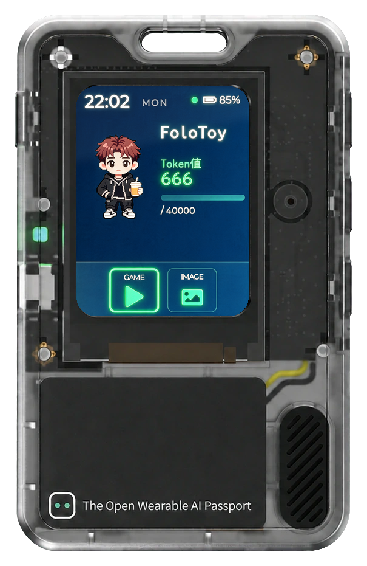
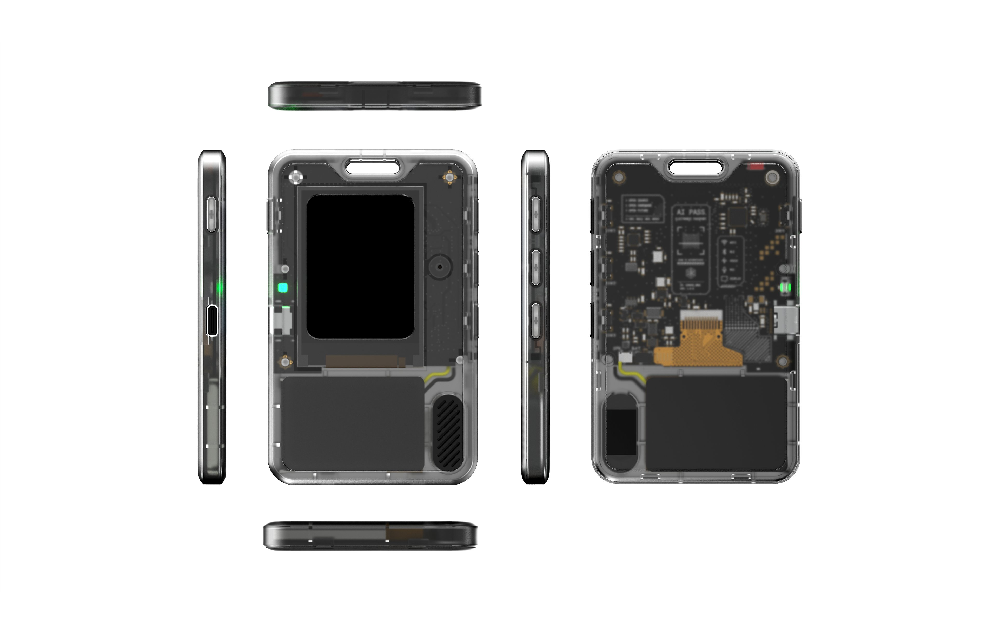
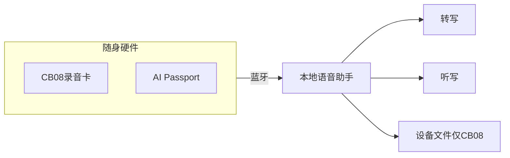

# 软件介绍

本地语音助手是面向 Mac 的**本地优先语音工作台**：转写与听写是底座，洞察与技能把会议变成可执行结果，工作区让你边听边互动；CB08 录音卡与 AI Passport 电子工牌可作随身输入。

  

---

## 核心功能

### 实时转写

- 流式预览 + 离线定稿，说话过程中即可看到文字
- 说话人区分，便于回顾「谁说了什么」
- 支持热词与精修；音频默认只在本机处理

### 系统听写

  

- 按住修饰键开始听写，松开结束
- 字幕式 HUD，注入到当前应用光标处
- 可选用麦克风、系统音频，或已连接的录音卡 / 工牌作为音源

---

## 特色能力

  

### 洞察

在旁听模式下，助手在本机持续理解会议内容，并以卡片形式给出洞察（如待办、风险）。默认**不自动执行**，由你确认后再行动。

### 技能

内置技能可一句话触发结构化产出：

| 技能 | 作用 |
|------|------|
| 会议总结 | 生成结构化纪要（摘要、结论、风险、待办等） |
| 待办提取 | 从本次与历次录音中整理待办列表 |
| 风险识别 | 识别讨论中的风险点 |
| 会议备忘 | 把值得记住的要点记入备忘 |
| 任务规划 | 把请求拆成可执行步骤 |
| 网络搜索 | 需要外网事实时检索并汇总出处 |

### 工作区实时互动

转写进行中，你可以在工作区：

- 随时提问或让助手归纳刚才一段话
- 对洞察卡片追问、改写或拆步骤
- 把结果落到文档 / 待办，而不是会后才整理

---

## 扩展硬件

通过蓝牙将随身硬件接入本地语音助手。同一时间建议只由一个程序连接设备。

### CB08 录音卡

  

- 实时语音上行到本机转写 / 听写
- 支持设备上录音文件的列表与下载（便于补录回传）

### AI Passport 电子工牌

  

  

- 实时语音上行（设备上不提供录音文件分区）
- 三键控制会议：开始 / 停止 / 暂停与继续
- 长按可触发听写（听写音源需设为工牌时）

---

## 其它

- 主题 AI Bot：旁听 / 指令 / 混合模式
- 可选配置你自己的云端大模型 API（文本才会出本机）
- 数据目录：`~/Library/Application Support/本地语音助手/`

返回 [首页](README.md) · [使用教程](GUIDE.md) · [下载](DOWNLOAD.md)
