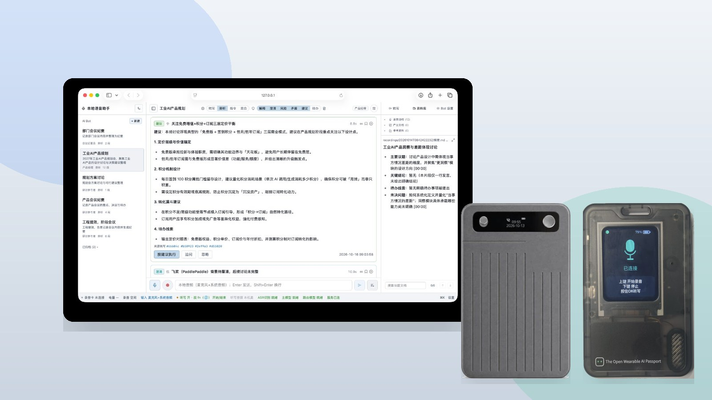
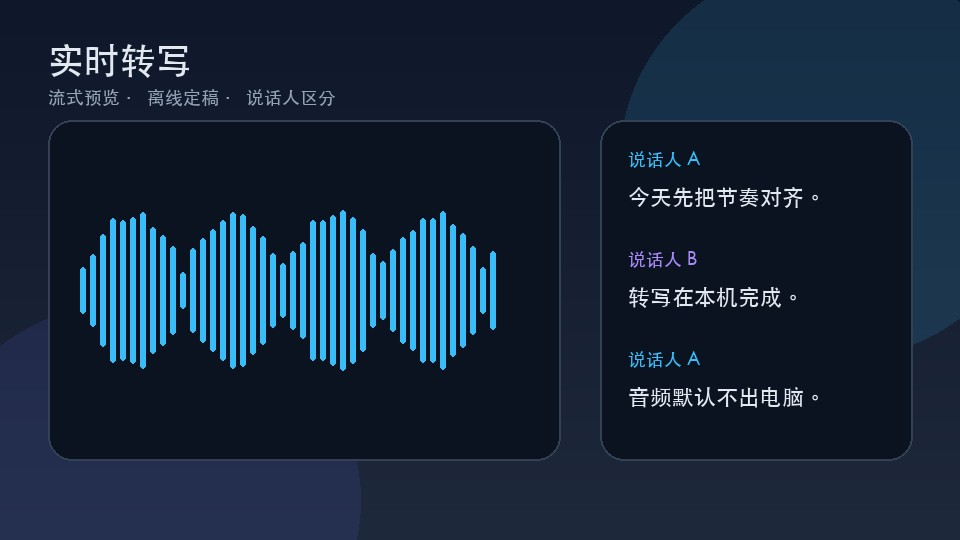
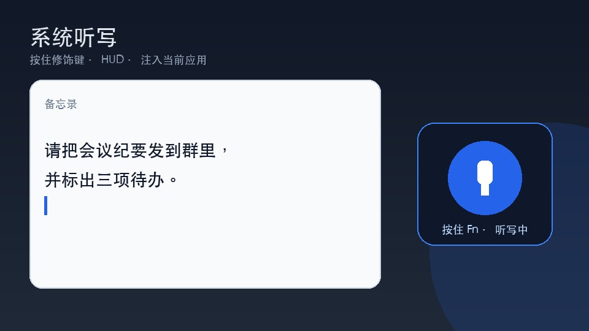
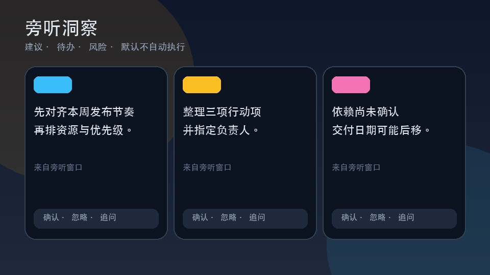
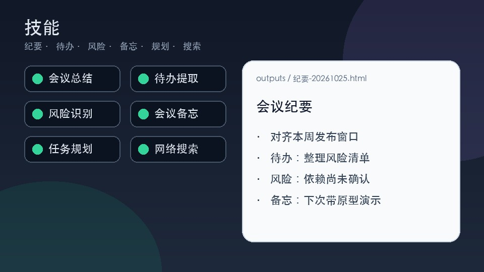
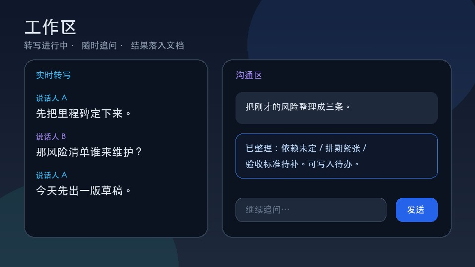

# 本地语音助手

  <strong>在你的 Mac 上完成实时转写与系统听写</strong> 
  本地优先 · 洞察与技能 · 可连接 CB08 录音卡与 AI Passport 电子工牌

  <a href="https://github.com/local-voice-assistant/local-voice-assistant/releases/latest">下载安装包</a>
  ·
  <a href="DOWNLOAD.md">安装说明</a>
  ·
  <a href="PRODUCT.md">软件介绍</a>
  ·
  <a href="GUIDE.md">使用教程</a>

  

---

## 核心功能：转写 + 听写

<table>
  <tr>
    <td width="50%" valign="top" align="center">
       
      <strong>实时转写</strong> 
      本机流式识别与离线定稿 · 说话人区分 · 音频默认不出本机
    </td>
    <td width="50%" valign="top" align="center">
       
      <strong>系统听写</strong> 
      按住修饰键说话 · 字幕式 HUD · 注入当前应用
    </td>
  </tr>
</table>

---

## 特色能力：洞察 · 技能 · 工作区

<table>
  <tr>
    <td width="33%" valign="top" align="center">
       
      <strong>洞察</strong> — 旁听时给出建议 / 待办 / 风险卡片，默认不自动执行
    </td>
    <td width="33%" valign="top" align="center">
       
      <strong>技能</strong> — 会议总结、待办提取、风险识别等，结果落入文档
    </td>
    <td width="33%" valign="top" align="center">
       
      <strong>工作区</strong> — 转写进行中随时追问，边听边互动
    </td>
  </tr>
</table>

内置技能：会议总结 · 待办提取 · 风险识别 · 会议备忘 · 任务规划 · 网络搜索

---

## 扩展硬件

支持通过蓝牙连接 **CB08 录音卡** 与 **AI Passport 电子工牌**，作为随身音源与会议控制。

详见 **[扩展硬件详情](HARDWARE.md)**（两款设备分别介绍）。

---

## 本地优先

- 识别、说话人区分与听写**默认在本机完成**
- 仅当你主动配置云端大模型 API 时，相关文本才会发往你选择的服务商
- 数据目录：`~/Library/Application Support/本地语音助手/`

---

## 文档

| 文档 | 说明 |
|------|------|
| [软件介绍](PRODUCT.md) | 功能详情 |
| [扩展硬件详情](HARDWARE.md) | CB08 / AI Passport 分项说明 |
| [下载与安装](DOWNLOAD.md) | Releases、Gatekeeper |
| [使用教程](GUIDE.md) | 首次启动与连接硬件 |
| [注意事项](NOTES.md) | 权限与数据目录 |
| [FAQ](FAQ.md) | 常见问题 |
| [用户协议](legal/USER_AGREEMENT.md) / [隐私说明](legal/PRIVACY.md) | 法务 |

反馈：[GitHub Issues](https://github.com/local-voice-assistant/local-voice-assistant/issues)  
本仓库托管产品说明与安装包，**不包含源代码**。
