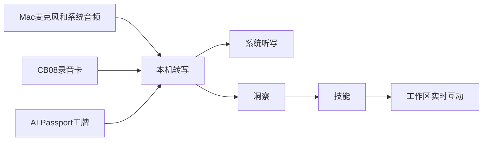
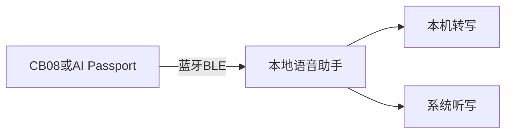

# 本地语音助手

**在你的 Mac 上完成实时转写与系统听写。**  
音频默认不出本机；需要时再接入你自己的云端模型。洞察、技能与工作区让会议内容立刻可用。

  

  <a href="https://github.com/local-voice-assistant/local-voice-assistant/releases/latest"><strong>下载 macOS 安装包（Apple Silicon）</strong></a>
  ·
  <a href="DOWNLOAD.md">安装说明</a>
  ·
  <a href="PRODUCT.md">完整介绍</a>

**当前版本**：0.1.0（预发布）· macOS 14.2+ · 临时签名（首次需右键打开）

> 本仓库托管**产品说明与安装包**，不包含源代码。

---

## 核心功能：转写 + 听写

| | |
|:---|:---|
| **实时转写** | 本机流式识别与离线定稿，说话人区分，会议过程边说边出字。 |
| **系统听写** | 按住修饰键说话，字幕式 HUD，文本注入到当前应用的光标处。 |

  

---

## 特色能力：洞察 · 技能 · 工作区

  

- **洞察**：旁听模式下本机生成洞察卡片（待办、风险等），默认不自动执行，由你确认。
- **技能**：会议总结、待办提取、风险识别、会议备忘、任务规划、网络搜索——一句话触发结构化结果。
- **工作区实时互动**：转写进行中即可在工作区提问、对卡片追问、让助手拆步骤或落文档。

---

## 扩展硬件

蓝牙接入，把随身设备变成转写与听写的输入端。

| 设备 | 能力 |
|------|------|
| **CB08 录音卡** | 实时语音上行；支持设备上录音文件列表与下载 |
| **AI Passport 电子工牌** | 实时语音上行；三键控制会议开始 / 停止 / 暂停；长按可触发听写 |

  
  &nbsp;&nbsp;&nbsp;
  

详见 [软件介绍 · 扩展硬件](PRODUCT.md#扩展硬件)。

---

## 本地优先

- 识别、说话人区分与听写**默认在本机完成**。
- 仅当你主动配置云端大模型 API 时，相关文本才会发往你选择的服务商。
- 数据目录：`~/Library/Application Support/本地语音助手/`

---

## 文档

| 文档 | 说明 |
|------|------|
| [软件介绍](PRODUCT.md) | 功能与硬件详情 |
| [下载与安装](DOWNLOAD.md) | Releases、Gatekeeper |
| [使用教程](GUIDE.md) | 首次启动与连接硬件 |
| [注意事项](NOTES.md) | 权限与数据目录 |
| [FAQ](FAQ.md) | 常见问题 |
| [捐赠](DONATE.md) | 自愿支持 |
| [用户协议](legal/USER_AGREEMENT.md) / [隐私说明](legal/PRIVACY.md) | 法务 |

## 反馈

Issues：https://github.com/local-voice-assistant/local-voice-assistant/issues  

源码仓库为私有，请勿要求在此提交功能代码。
